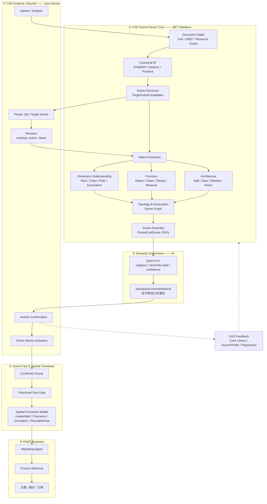

# RSDP CAD Scene Engine 目标架构

> **版本：** v1.1
> **日期：** 2026-10-05
> **状态：** 目标架构（Architecture Target，经 601 类深化图实战校准）
> **v1.1 修订：** 新增「三种 Scene」概念与四契约浓缩；Fact Gate 明确为字段级；
> Feedback 收敛为治理闭环（不直接反哺 Parser）；SourceProfile 结构化与 80/20 原则；
> Data Plane / Control Plane 表述；对外承诺口径改为"多级降级与人工确认"。
> **前置文档：** `CAD户型导入架构设计.md`（P1~P3 时代，本文取代其 Parser 内部视角）、
> `../RSDP_CAD_Scene_Parser_升级开发设计文档_V1.2.3_SceneRevision原子激活收口版.md`（P0 契约，已实施）
> **驱动实证：** `601-含尺寸标注(1).dwg` 深化施工图——148 个匿名块封装全部几何、多套方案同坐标叠图、
> 房间名标签堆叠塌缩、141 个 DIMENSION 只有线性值可用。该文件暴露了"Room Parser + Furniture Parser
> 不断打补丁"路线的极限，促成本收口。

---

## 0. 一句话定位

**`rsdp-cad-parser` 从"户型房间解析器"升级为"CAD Scene Understanding Engine"（.NET，无状态、确定性、可回归）；
Java Server 负责业务编排、Revision、人工确认与 Agent 接入。**

对外一句话：**Java 管生命周期，.NET 负责 CAD 事实解析，Qwen 只补语义，
Fact/Constraint 决定哪些数据能进入业务，RSDP Business 消费最终可信事实。**

Room 不再是解析的唯一目的，只是 Scene Object 的一种；Furniture / Wall / Door / Dimension 全部平级。

### Java 的本质：CAD 分析业务生命周期控制器（不是算法层）

```text
CAD Analysis Lifecycle
├── 原始文件管理
├── Analysis 创建
├── Parser Job 调度
├── Target Scene 选择
├── Analysis Revision
├── Raw Scene Snapshot（冻结不可变）
├── Semantic Enrichment 编排
├── Human Confirmation
├── Working Scene
├── Atomic Activation
└── Feedback / Audit
```

---

## 1. 五大域分层

```text
┌──────────────────────────────────────────────────────────┐
│ ① CAD Analysis Lifecycle（Java Server）                  │
│ 上传 / Analysis / Revision / Job / 人工确认 / Scene 激活  │
└──────────────────────────────────────────────────────────┘
                         │
                         ▼
┌──────────────────────────────────────────────────────────┐
│ ② CAD Scene Parser Core（.NET / ACadSharp / NTS）        │
│ CAD → Canonical IR → Scene Objects → Relations           │
└──────────────────────────────────────────────────────────┘
                         │
                         ▼
┌──────────────────────────────────────────────────────────┐
│ ③ Semantic Enrichment（Vision / LLM）                    │
│ 只做类别、标签、语义，不做尺寸和几何事实                  │
└──────────────────────────────────────────────────────────┘
                         │
                         ▼
┌──────────────────────────────────────────────────────────┐
│ ④ Scene Fact & Spatial Constraint                        │
│ Confirmed Scene → Fact Gate → Spatial Constraint Model   │
└──────────────────────────────────────────────────────────┘
                         │
                         ▼
┌──────────────────────────────────────────────────────────┐
│ ⑤ RSDP Business                                          │
│ Marketing Agent / Product Retrieval / 方案 / 报价         │
└──────────────────────────────────────────────────────────┘
```

**分层铁律：**

1. ② 保持无状态：输入 CAD + options，输出 CadScene JSON；数据库/Revision/用户确认全部归 ①。
2. ③ 只回答"这是什么"（category/label/confidence），永远不估算尺寸；尺寸/面积等事实只来自 ② 的几何。
3. ⑤ 只允许消费 ④ 之后的数据：Initial Scene ≠ Confirmed Scene ≠ Hard Fact。
4. 层间不越权：Java 不算几何、.NET 不调大模型、Qwen 不猜尺寸、Agent 不自己算户型。

### 三种 Scene（全系统统一概念）

不是只有一个 CadScene，而是三个阶段产物：

| Scene | 产出方 | 性质 | 允许内容 |
|---|---|---|---|
| **ParsedCadScene** | .NET Parser | 自动、**不可变**、可重复解析、可回归 | UNKNOWN / NEEDS_REVIEW 随意存在 |
| **Working Scene** | Java 组合 | Parsed + Semantic Evidence + Human Edits | 用户正在修改的版本（working revision） |
| **Confirmed Scene** | 用户确认 + 原子激活 | 进入 Fact Gate 的唯一入口（active revision） | 字段级事实资格，见 §7 |

数据契约（已落地实现，文档化为契约）：
- **Parser 输出 ParsedCadScene 后不再被 AI 修改**——Revision 快照 raw_result 冻结；
- **SemanticEnrichmentResult 是独立语义证据**（predictedCategory/semanticLabel/confidence/source），
  以带来源标记的字段挂在 Java 侧对象上（semantic_source=vision_qwen3vl + vision_confidence +
  confirmation_status=AUTO），**绝不回改 Parser JSON、绝不覆盖几何**；
- 派生 Revision 时经 matched_from_object_id 继承，人工确认走 PUT /furniture 沉淀 Diff。

```text
DWG → ParsedCadScene → SemanticEnrichment → Working Scene
      → Human Confirmation → Atomic Activation → Confirmed Scene → Fact Gate
```

### 1.1 最终总览图



---

## 2. 现状映射（哪些已在，哪些是真空白）

601 排查与 P0/P1 建设后，五域中相当一部分已存在，**不要重复造**：

| 目标架构组件 | 现状（截至 2026-10-05 工作区） | 差距 |
|---|---|---|
| Parser stateless / 不写业务库 | ✅ 一直如此 | 无 |
| Scene Revision 模型 + 原子激活 | ✅ V19/V20：`floor_plan_scene_revision` + working/active/latest 指针 + 激活校验器 + Revision 化编辑 | 无 |
| Feedback Domain | ✅ `cad_analysis_feedback`（ADD/DELETE/UPDATE/SPLIT/MERGE Diff） | 需接 Profile/回归用例沉淀 |
| Canonical IR 溯源 | 🟡 FlatEntity 已带 SourceHandle/InsertPath/BlockDefinitionName/EffectiveLayer/TransformApplied | 溯源是附加字段，不是一等结构 |
| TargetSceneCandidates | ✅ 标签聚类 + targetId 切换 | 同坐标叠图拆不开（§4.3） |
| BlockRoleClassifier | ✅ SCENE_CONTAINER/ARCHITECTURE/FURNITURE/ANNOTATION/UNKNOWN | 需移到 Object Extraction 前置位 |
| Furniture 结构化（清洗/去重/分组/视觉） | ✅ P1-A/B/C 已上线（candidateStatus/duplicateGroup/visionGroup/isolation） | OBB 与 footprintArea 未收口 |
| 建筑回退链 | ✅ 直接矢量 → 块展开矢量 → 栅格形态学重建（P1-E） | 未策略化、无 WallPair 矢量重建 |
| Semantic Enrichment Service | ✅ FloorPlanFurnitureSemanticService（Java 侧，双图，置信度分级） | 仅家具；房间语义在 vision 通道散落 |
| Fact Gate | 🟡 Scene Activation Validator 是雏形 | 需正式命名与规则化 |
| **Dimension Understanding** | ❌ 只有 Measurement + TextMiddlePoint | **最大空白，见 §6** |
| **Relation Engine / Scene Graph** | ❌ 只有 RoomAssigner（家具 PIP 归属） | 真空白 |
| Parser Profile | ❌ 图层词表硬编码在 ParserOptions | P2 |
| **Scene Isolation（叠图分离）** | ❌ | P2，难度见 §4.3 |

---

## 3. Parser Core：8 个 Stage

```text
DWG / DXF
   │
   ▼
① Document Intake          文件/单位/版本/XREF/平面性/资源守卫
   ▼
② Canonical IR             CadEntityRef + CadInstance + CadPrimitive
   ▼
③ Scene Discovery          TargetSceneCandidates → 选定 Scene
   ▼
④ Object Extraction        Architecture / Furniture / Annotation 三通道
   ▼
⑤ Dimension Understanding  Raw → Chain → Role → Association → Metric
   ▼
⑥ Topology & Association   Furniture→Room、Door→Wall、Dimension→Object…
   ▼
⑦ Scene Assembly           CadScene 统一输出
   ▼
⑧ Quality / Fact Evaluation parseStatus + capabilities + qualityIssues
```

### 3.1 Stage ① Document Intake

模块：`CadDocumentLoader` / `UnitResolver` / `CoordinateNormalizer` / `PlanarityChecker` / `XrefInspector` / `ResourceGuard`。

输出 `CadDocumentContext`（inputHash、cadVersion、unit{rawUnit,scaleToMm,scaleAssumed,confirmed}、coordinateSystem、hasXref）。
单位/Block Transform/坐标是全局基础事实，不允许各 Extractor 各算一遍。

> 现状：CadDocumentLoader/UnitResolver/XrefDetector/资源守卫已在，只需收敛为 Context 对象。

### 3.2 Stage ② Canonical IR（最重要的底层改造）

不再把所有东西塞进 FlatEntity。三分：

```text
CadEntityRef    原始身份：handle / entityType / layer / owner / space / blockPath / attributes
CadInstance     INSERT 实例：instanceId / blockDefinition / transform / parentInstance / children
CadPrimitive    归一几何：LINE / CURVE / POLYGON / TEXT / DIMENSION（含角色化载荷）
```

核心原则：**Source Entity ≠ Geometry Primitive ≠ Scene Object**。
601 的全部补丁（标签堆叠、方案容器、0 层混线）根因都是块展开后丢失来源与角色。

> 迁移策略（strangler）：FlatEntity 现有溯源字段并入 CadEntityRef；CadInstance 由现有
> BlockResolver.InsertNode 直接晋升；CadPrimitive 承接 Points/Rings/TextPos。逐 Extractor 迁移，
> 每步金样本回归零差异。

### 3.3 Stage ③ Scene Discovery

`TargetSelector` 升级为 `SceneDiscoveryEngine`，输出：

```text
TargetSceneCandidate {
  targetId, sourceSpace, bounds,
  containedInstances, architectureScore, roomLabelScore, dimensionScore,
  furnitureDensity, preview, confidence
}
```

**先选 Scene，再做 Object Extraction**；去重/归属等只在 Scene 内做。

> ⚠️ 难度校准（601 实证）：多套方案同坐标精确叠放时，bbox/标签聚类拆不开。
> 强隔离需按 INSERT 来源分组（哪些顶层块属于哪套方案），标为 P2。
> P1 先做弱隔离：同位置同几何去重组（已上线）+ 重复组仅 PRIMARY 进 Scene（待做）。

### 3.4 Stage ④ Object Extraction：三通道并行

```text
                    Canonical IR
            ┌──────────┼──────────┐
            ▼          ▼          ▼
      Architecture  Furniture  Annotation
```

前置：`BlockRoleClassifier`（已存在）对每个 Instance 定角色。

**Architecture 通道**（`ArchitectureExtractor`）：

```text
WallCandidateExtractor → WallPairDetector → DoorDetector → WindowDetector
→ OpeningDetector → RoomBoundaryBuilder → RoomPolygonizer
```

墙体多策略（证据组合，不让单一策略直接定论）：
Strategy1 HATCH 实心（含金样本 ANSI31）/ Strategy2 墙图层线 / Strategy3 双平行线 WallPair /
Strategy4 块展开建筑几何 / **Strategy5 WIPEOUT/SOLID 墙身**（P1-E 已实证）/
Strategy6 栅格形态学重建（P1-E  RasterRoomReconstructor，最终回退）。
统一产出 WallCandidate → WallResolver → Wall Object。

**Furniture 通道**（P1-A/B/C 已上线，按此形式化）：

```text
FurnitureCandidateExtractor（Insert/ExplodedGeometry/VisionAssist 三策略）
→ CandidateCleaner（碎件/超大/异常比例 → REJECTED 标记不删除）
→ DuplicateGrouper（同块+指纹+尺寸+旋转+位置网格 → PRIMARY/DUPLICATE 成组不删除）
→ GeometryMeasurer（AABB 现状；OBB 与 footprintPolygon 待收口）
→ SemanticResolver（交给 ③ Semantic Enrichment，Parser 内不跑模型）
```

**Annotation 通道**：文字/标签/标注集合块（601 的整户标签堆叠块即此类）。

### 3.5 Stage ⑤ 见 §6（独立大节，本次架构的最大新增域）

### 3.6 Stage ⑥ Topology & Association

从"独立数组"升级为 Relation Engine，产出 Scene Graph：

```text
Furniture→Room（锚点 PIP + 轮廓重叠复核，已有 RoomAssigner 晋升）
Door→Wall / Window→Wall / Opening→Wall
Dimension→Object（→ObjectFeature）
Room→Room（邻接）/ Wall→Room / Furniture→Wall（靠墙）
```

Furniture→Room 正式算法：锚点 PIP + footprint 重叠比例（如 70% 客厅 / 30% 过道 → NEEDS_REVIEW），
不靠"最近房间标签"。

### 3.7 Stage ⑦ Scene Assembly

统一输出 `CadScene`：

```text
CadScene
├── metadata（inputHash / parserVersion / configHash）
├── unitResolution
├── targetScene / targetSceneCandidates
├── rooms[] / walls[] / doors[] / windows[] / furniture[] / dimensions[]
├── relations[] / dimensionChains[]
├── qualityIssues[]
└── capabilities（rooms/walls/doors/windows/furniture/dimensions 分别分级）
```

> 迁移策略：**Stage ⑦ 先行**——先定义 CadScene 作为装配层输出（现有各 Extractor 原位保留），
> 再逐 Stage 迁移。禁止大重写；每次迁移金样本 + 全部契约测试零差异。

### 3.8 Stage ⑧ Quality / Fact Evaluation

`parseStatus`（SUCCESS/PARTIAL/NEEDS_REVIEW/FAILED，success=false ⟺ FAILED）+
`capabilities` 分域分级 + `qualityIssues`（BLOCK/WARN 分级）。
Parser 永远不输出"看起来成功但未经质量评估"的数据。

---

## 4. 关键设计修正（601 实证驱动）

### 4.1 面积字段三分（收口语义）

```text
Room.geometryAreaM2        房间多边形实测
Furniture.envelopeAreaM2   AABB/OBB 包络（现状 GeometryWidthMm×DepthMm，需正式命名）
Furniture.footprintAreaM2  真实闭合多边形面积（未来）
```

不允许都叫 `area`。

### 4.2 去重不成文规则：只标记不删除

REJECTED / DUPLICATE / SCENE_CONTAINER 全部"标记 + 抑制展示"，绝不物理删除——
601 实测 63 对近距同块同尺寸实例是栏杆/餐椅合法阵列，简单删除即误杀；且 Scene 修正后可恢复。

### 4.3 Scene Isolation 的现实难度

多方案**同坐标叠图**（非并排混排）无法用空间聚类分离。短期=弱隔离（去重组 PRIMARY 准入），
长期=按 INSERT 来源的方案分组（P2）。不要在 P1 承诺强隔离。

### 4.4 SourceProfile（不只是图层词表）+ 80/20 演进原则

ParserOptions 词表正则升级为结构化 SourceProfile（Global → Tenant → Source 三级，P2）：

```text
SourceProfile
├── Layer Mapping          图层 → 角色映射
├── Block Name Pattern     块名语义（如 SF-* → SOFA）
├── Dimension Layer Rules  标注图层规则
├── Wall/Furniture Strategy Preference  策略偏好（如 PARALLEL_LINE_FIRST）
├── Tolerance Profile      容差组
├── Unit Hint / Text Pattern / Known Block Semantic
└── Confidence / Evidence  来源证据
```

**80/20 演进原则**：同一 CAD 语义体系的画法差异（80%）→ SourceProfile 解决；
真正的新几何模式/新实体类型/算法能力缺口（20%：动态块、代理对象、MLINE 墙、
新 Dimension 类型）→ Parser Core 演进。不为"不改代码"把 Profile 做成第二套编程语言。

**对外承诺口径**：不写"什么 CAD 都能完全识别"；写"对非规范 CAD 支持多级降级与人工确认"——
能识别多少明确告知、不确定处明确标出、人工可修正不阻塞流程（XREF 缺失/代理对象/损坏/
纯图片嵌入/大量三维/字体缺失/加密对象必然存在）。

---

## 5. Java Server 职责（大部分已在）

```text
cad/
├── analysis/    FloorPlanAnalysisService / FloorPlanRevisionService   （已有）
├── parser/      CadParserAdapter                                      （已有 CadFloorPlanParser）
├── scene/       ScenePersistence / SceneConfirmation / SceneActivation（已有，按此命名归拢）
├── semantic/    CadSemanticEnrichmentService                          （P1-C 已建，房间语义待并）
├── feedback/    CadFeedbackService                                    （cad_analysis_feedback 已有）
└── constraint/  SpatialConstraintService                              （P3）
```

一次完整链路：

```text
上传 DWG → 创建 Analysis + Revision 1 → Parser Job
→ Scene Discovery → TargetSceneCandidates →（用户/系统选 Scene → Revision 2）
→ Architecture/Furniture/Dimension/Relation → Initial Scene（快照冻结）
→ Semantic Enrichment（家具类别等）→ 前端人工确认（Working Revision）
→ Scene Activation Validator → 原子激活 → Confirmed Scene
→ Fact Gate → Spatial Constraint → Marketing Agent
```

---

## 6. Dimension Understanding Domain（P1 核心新增，不是辅助工具）

**动机**：深化施工图的 DIMENSION 是最丰富的结构化信息；601 有 141 个 DIMENSION 但只留了
"测量值+文字中点"，定义点/延伸线起点全丢，尺寸链/归属无从谈起。
另一条价值：尺寸链可反推房间净尺寸，**绕开墙体围合**——断线图纸的第二条腿。

### 6.1 模块拆分

```text
RawDimensionExtractor      只读事实：measurement/definition points/extension points/
                           text/direction/layer/source（不判断"这是谁的尺寸"）
ExplodedDimensionDetector  炸开尺寸识别（散线+文字重组为逻辑尺寸）
DimensionChainBuilder      共线分段链：2600+3000+1800+3100+3700 → 14200
DimensionRoleClassifier    BUILDING_OVERALL / ROOM_CLEAR_SPAN / WALL_SEGMENT /
                           DOOR_WIDTH / WINDOW_WIDTH / FURNITURE_WIDTH / FURNITURE_DEPTH /
                           CLEARANCE / UNKNOWN
DimensionAssociationEngine Dimension → Object → ObjectFeature（如 900→Door D3→OPENING_WIDTH）
DimensionGraphBuilder      内部约束模型（WallFace A ─2600─ WallFace B ─14200─ WallFace F）：
                           尺寸链校验 / 几何冲突发现 / 墙体修复辅助 / 净距判定
MetricResolver             Room 宽深/净距的事实来源仲裁（几何实测 vs 标注链）
```

### 6.2 落库（新增表，进 schema/06 域 + Flyway）

```text
floor_plan_dimension           Raw Dimension（analysis_id + analysis_revision 作用域）
floor_plan_dimension_relation  Dimension → Object 关联（角色 + 置信度 + 确认状态）
```

### 6.3 边界

DimensionGraph 是 Parser 内部约束模型，不是业务表；只有确认后的关联进入业务事实。

---

## 7. Fact Gate（④域收口，字段级）

```text
CadScene → 人工确认 → Scene 原子激活 → Confirmed Scene → Field-level Fact Gate → Spatial Constraint
```

**Fact Gate 不是"确认过就整个 Scene 可信"，而是"确认后，字段才有资格按依赖关系成为硬事实"。**
即使 Scene 已激活：家具类别/宽度已确认 → HARD FACT；窗户识别不完整 → UsableWall 不硬。
窗户缺陷绝不允许传染沙发宽度。

Spatial Constraint 的位置不可动：Confirmed Scene → Fact Gate → Spatial Constraint → Agent。
Agent 收到的必须是业务条件（Room Area / UsableWall / PlaceableArea / DoorClearance /
WindowClearance / Circulation / FurnitureFootprint），不是一坨 polygon 坐标。

**架构验收标准：Marketing Agent 对 CAD 技术细节全盲**——不知道 ACadSharp / INSERT /
匿名块名 / HATCH / DimensionChain / WallPair，只消费 Fact Gate 之后的业务事实 JSON。
Fact Gate 之前的任何数据不允许进入 Agent。

---

## 8. 数据库模型（Scene Revision 已在，补充部分）

已有（V19/V20）：`floor_plan_analysis`（业务对象）+ `floor_plan_scene_revision`（版本快照）+
`floor_plan_room` / `floor_plan_furniture`（Revision scoped）+ `cad_analysis_feedback`。

待补：`floor_plan_wall` / `floor_plan_door` / `floor_plan_window`（Stage ④ 对象化时）、
`floor_plan_dimension` + `floor_plan_dimension_relation`（§6.2）。

### 8.1 Feedback 治理闭环（不直接反哺 Parser）

人工 Diff 绝不直接改变 Parser 行为（匿名块 `*U74` 换个 DWG 就是另一个东西，
"今天改成 SOFA、明天全局生效"是事故而不是智能）：

```text
Human Diff → cad_analysis_feedback → Case Library → 统计
→ SourceProfile Candidate → 人工 Review → 纳入回归测试 → Approved Profile → Parser
```

### 8.2 数据面 / 控制面

系统不是严格单向——对外表述为：**主业务数据单向流动，反馈走独立治理闭环**。

```text
Data Plane（主数据面）：CAD → Parser → Working Scene → Confirmed Scene → Fact → Business
Control Plane（反馈控制面）：Human Diff → Feedback → Profile / Regression → Parser Evolution
```

（另有 Scene 候选 → 用户选择 → Parser 重解析 的选择回路，属主数据面内的合法往返。）

### 8.3 四契约浓缩

```text
Parser Contract   Input: CAD + ParserProfile → Output: ParsedCadScene
                  不保存业务状态、不改数据库、不知道用户是谁
AI Contract       Input: Scene Object + Visual Context → Output: Semantic Evidence
                  不产生毫米/面积/坐标等几何事实
Java Contract     Parsed Scene + Semantic Evidence + Human Edit = Confirmed Scene Revision
                  负责生命周期与"谁是当前生效事实"
Business Contract Confirmed Scene → Fact Gate → Spatial Constraint → Agent
                  Agent 只能消费经过事实门的业务事实
```

### 8.4 最终形成的三个长期资产

1. **CAD Scene Engine**：各种 CAD → 统一 CadScene（算法资产）
2. **CAD Knowledge/Profile**：不同设计公司/画法/Layer/Block 的 SourceProfile（知识资产）
3. **Confirmed Case Library**：真实 CAD + Parser Prediction + Human Confirmed + Diff
   （数据资产；远期可用于训练 Furniture/Layer/Dimension 关联/Scene 分类模型，仅远景，不进路线门禁）

**演进方式收口**：顶层五层架构不再随单张图纸改动。新问题 = 补策略 / 补 Profile /
补回归样本：尺寸复杂 → 补 Dimension Strategy；匿名块 → 补 SourceProfile/Semantic；
家具炸开 → 补 Furniture Strategy；双线墙 → 补 Wall Strategy。

---

## 9. 分期路线

```text
P0（已交付）   Canonical IR 溯源 / Block 实例树 / Unit / TargetScene / Revision / 原子激活
P1（已交付）   家具结构化（清洗/去重/视觉语义分组）/ 建筑回退链（块展开+栅格重建）/ WIPEOUT 墙身
──────── 当前位置（工作区待 commit）────────
P1.5  收口提交 + CadScene 装配层（Stage ⑦ 先行，Extractor 不动）
P2-A  Dimension Understanding（§6 全域：Raw 全字段 → Chain → Role → Association → Metric）
P2-B  Canonical IR 正式化（CadEntityRef/CadInstance/CadPrimitive 三分，strangler 迁移）
P2-C  Architecture 多策略化（WallResolver 证据组合；WallPairDetector 矢量重建）+
      家具 OBB/footprint 收口 + 重复组 PRIMARY 准入（弱隔离）
P2-D  Exploded 家具/尺寸、Source Profile、Scene Isolation 强版
P3    UsableWall / Circulation / PlaceableArea / Furniture Fit / CAD→RSDP Product / Marketing Agent
```

每期门禁：金样本回归零差异 + 契约测试全绿 + `make check-migration-sync` 零差异 + 实体对账通过。

---

## 10. 不变量（Invariant）

1. Parser 无状态；不写业务库。
2. 视觉/LLM 不产出几何事实（尺寸/面积/坐标）。
3. Initial Scene ≠ Confirmed Scene ≠ Hard Fact；⑤ 只消费 Fact Gate 之后的数据。
4. 清洗/去重/剔除只标记不删除。
5. 任何 Stage 迁移不得改变金样本可观察产出（除非该产出被证明是缺陷，且修正进新契约测试）。
6. Source Entity ≠ Geometry Primitive ≠ Scene Object，三层身份全程可溯源。
